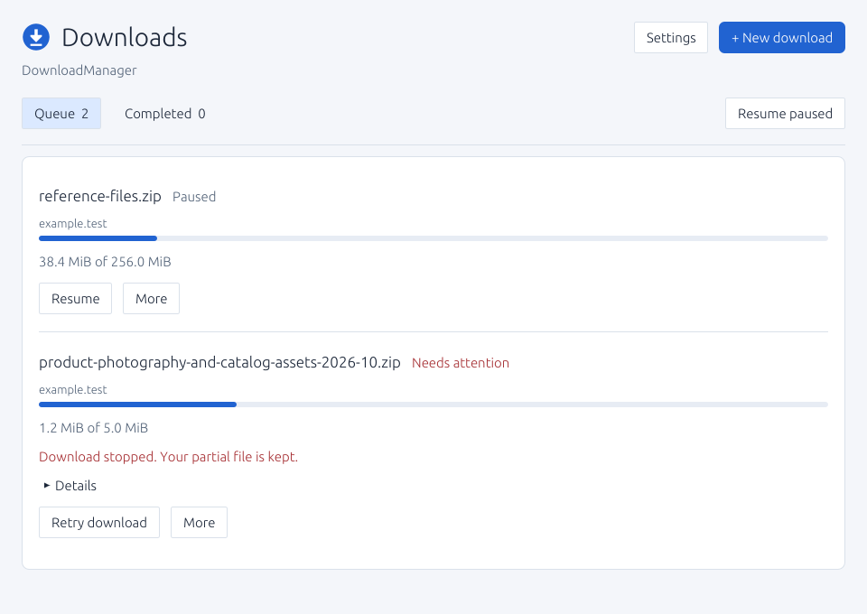
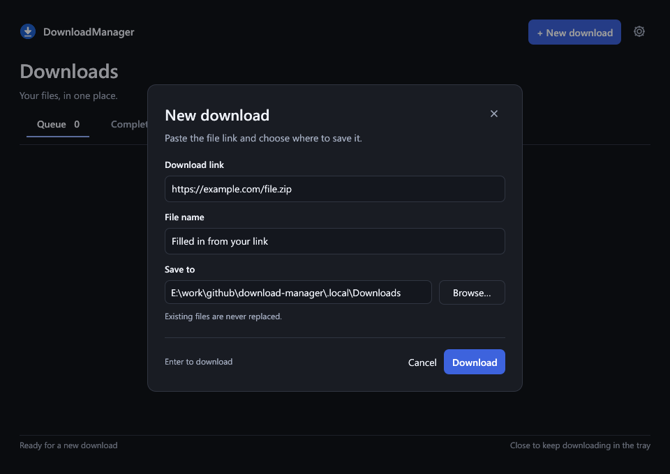
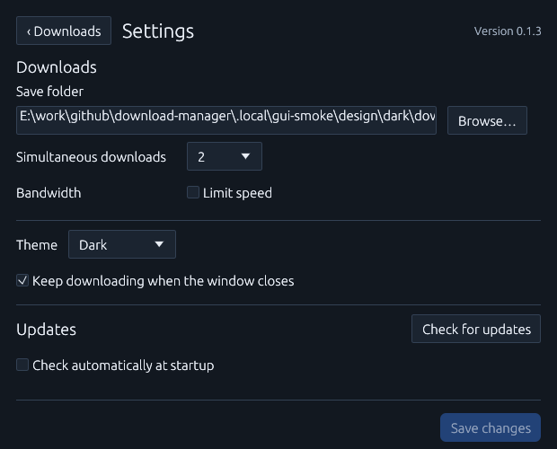
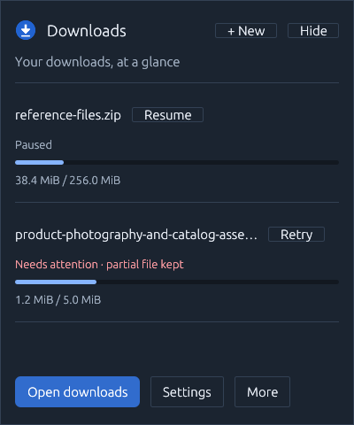
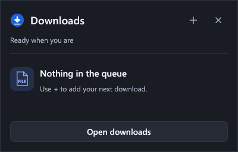
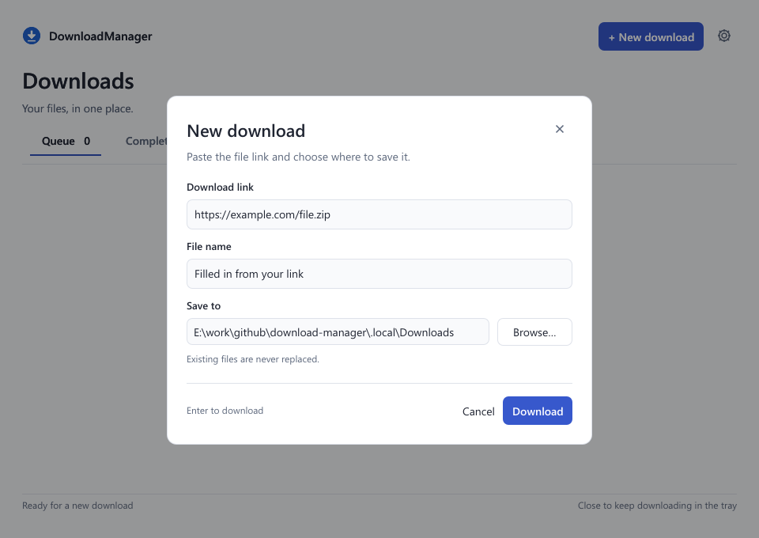
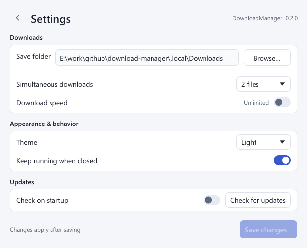
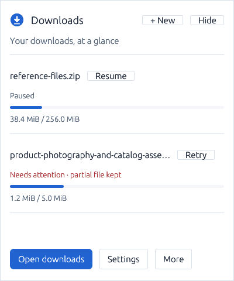
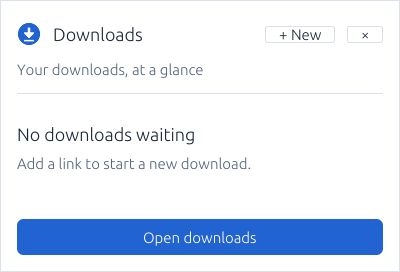

# DownloadManager

A native Windows download queue with conservative, checkpointed HTTP(S) resume. Version **0.1.3** is a local, unpublished implementation with reviewed native screenshots and bounded runtime diagnostics. Full interactive validation is still pending.

Independent MIT-licensed implementation. No affiliation with Internet Download Manager; no competitor source or artwork is used. There is no claim of universal resume support or universal speed improvement.

## Capabilities

- Paste an HTTP(S) URL, choose an existing destination folder with Browse or enter its path, and edit the filename.
- Queue downloads; pause, resume, cancel, retry and explicitly restart from zero.
- Reorder queued items, pause all transfers and resume paused items.
- Display bytes transferred, known/unknown size, recent transfer speed and estimated time remaining when available.
- Configure 1–4 simultaneous downloads and a shared bandwidth limit (KiB/s; 0 means unlimited).
- Keep queue/history and settings across restarts. Unfinished jobs reopen paused; no download resumes without a user action.
- Review completed downloads separately and remove completed entries from history while keeping their files. Downloaded files are never automatically opened or executed.
- Keep transfers running in the tray, with a compact download popup, pause/resume/retry actions and a native context menu. A second launch opens the existing instance.
- Use one consistent application icon in the EXE, window, interface and tray, with embedded sizes from 16 to 256 pixels.
- Choose dark or light appearance in Settings. Dark is the default; the saved theme applies to the queue, settings, dialogs and compact popup.
- Check for stable GitHub releases manually or on startup (enabled by default, persistent opt-out). User-initiated installation verifies SHA-256 and stages a Windows x64 portable update before closing/restarting the application.

There is one connection per download. Parallel segments, browser integration, authentication/cookie management, site extraction and scheduled downloads are outside this version.

## Use

1. Start `DownloadManager-v0.1.3.exe` on Windows x64.
2. Select **New download** (Ctrl+N). Paste a URL, select **Browse…** to choose a folder (or enter its path), and choose a filename. Select **Download**. Invalid input stays in the form so you can correct it.
3. Use **Pause**, **Resume**, or **Retry download** on a row. **More** contains the save location, queue reordering and **Cancel download**. Cancel preserves partial data.
4. If the server cannot safely resume, choose **More → Restart from zero…** and confirm removal of that task's partial data. Existing final files remain protected.
5. Open **Settings** to change download defaults and limits, choose **Dark** or **Light** from the **Theme** list, disable startup checks or check/install an update. **Browse…** also chooses the default download folder. Theme selection previews immediately; **Save changes** keeps it across restarts. **‹ Downloads** returns to the queue and discards unsaved appearance changes.

By default, closing the window keeps downloads running in the tray. Single-click the tray icon to show or hide a compact list of up to four unfinished downloads; **Open downloads** opens the full queue. Double-click opens the queue directly. Right-click opens **New download**, **Pause all**, **Resume paused**, **Settings** and **Quit DownloadManager**. The **×** button, Escape or clicking outside dismisses the popup. Settings and Quit are available from the tray context menu; the popup keeps only quick download actions. Disable **Keep downloading when the window closes** in Settings to exit on close instead. If Windows refuses tray registration, the application stays accessible in its regular window and closing exits.

**Quit DownloadManager** requests checkpoints and waits for active workers to stop. A pending network read/request can delay exit until its timeout. A state-write error restores the window and displays a recovery message.

## Reliability rules

Partial files are hidden-name siblings of their destination, `.download-manager-ID.part`, with a `.json` checkpoint. Data is flushed before an atomic checkpoint replacement. Each checkpoint records the committed prefix length and SHA-256; retries verify that prefix and discard only an uncommitted tail. Checkpoints occur every 2 MiB and on an orderly pause or transfer error, where storage remains writable.

Resume sends `Range` and `If-Range` together and requires a strong ETag, matching final redirect URL, `206 Partial Content`, exact `Content-Range` and consistent lengths. Changed entities, ignored ranges, missing/weak validators, HTTP errors and encoded bodies are rejected without appending. Servers offering only Last-Modified can download normally, but this version requires an explicit restart after interruption. A `416` response never silently marks a file complete.

The body streams in bounded buffers; unknown-length bodies complete at a clean EOF. Finalization uses a same-directory Windows move without replacement. A retained completion receipt covers a crash between that move and durable queue completion. Checkpoint hashes detect local partial-file changes; they are not a publisher signature or a malware check.

Normal TLS certificate/hostname verification remains enabled. HTTPS transfers cannot redirect to HTTP. Redirects are limited to eight. Network/TLS/timeout and disk errors appear per download; automatic retry loops are deliberately absent.

## Data and updates

Default state location: `%LOCALAPPDATA%\DownloadManager\state.json`. Set `DOWNLOAD_MANAGER_DATA_DIR` to an absolute isolated directory for development. One instance may own a data directory at a time; another launch signals that instance through Windows named events rather than starting a second queue. URLs and paths are stored locally in plain JSON; URL query strings can contain private tokens. Credentials embedded in URLs are rejected.

Canonical future repository: [siarheisinelnikau/download-manager](https://github.com/siarheisinelnikau/download-manager). It was not created, queried for releases or published during development. A missing repository/release is reported as unavailable, not up to date. Startup no-update results and transient check errors stay in settings without modal dialogs.

Installation supports the single Windows x64 asset `DownloadManager-vVERSION.exe`. It requires the GitHub SHA-256 asset digest or a matching `SHA256SUMS.txt` entry. The helper waits for the application to exit, creates a backup beside the installed EXE, replaces it and relaunches it. Settings, queue and download data remain in their existing locations. The installed EXE keeps its current filename after an in-place update. No administrator prompt or unattended install is used. Read-only installation folders produce an error and require moving the portable app to a writable folder.

The shared `rust-auto-updator` core owns release checks, verified downloads and atomic replacement/rollback. New helpers stage beside the EXE under `.DownloadManager-update-*`, retain `previous.exe` during replacement, and clean known staging files only after updated host initialization. The application saves and stops its queue before handoff. It still accepts the helper protocol used by earlier versions and reads their retained error reports. Real release download, replacement, rollback and restart still require manual validation.

## Build and checks

Source builds require the sibling `../rust-auto-updator/crates/rust-auto-updator` workspace. The reusable core is currently a local dependency; standalone CI must provision both checkouts before building. No registry/GitHub publication is implied.

Required: Windows x64, Rust **1.95+**, the `x86_64-pc-windows-msvc` target, Visual Studio C++ build tools and Windows SDK. The GUI uses egui 0.33.3 with CPU rasterization and Win32 GDI presentation; the executable has no OpenGL/DirectX rendering dependency. Windows 10/11 x64 is the intended target, with broader interactive compatibility still pending. Other OS/architecture builds are not release targets for v0.1.3.

```powershell
./scripts/check.ps1 -Offline
# On a normal developer PC with permitted local sockets:
./scripts/check.ps1 -Offline -Loopback
./scripts/package.ps1 -Offline
```

Omit `-Offline` when dependency downloads are needed. All Cargo commands use two jobs and a repository-local `target`. The package script builds the MSVC target with a static CRT and prepares `dist/DownloadManager-v0.1.3.exe`, `SHA256SUMS.txt`, license notices and release notes. It does not run the GUI, run the updater or publish anything. The CI workflow performs checks including synthetic loopback tests and uploads a build artifact, without creating releases.

`Cargo.toml` is the version source for the UI, Windows file/product properties and executable naming. Changed executables receive a new version before delivery; ordinary local recompilations do not. The inspection script checks that the packaged Windows version matches the manifest. Build notes identify the changes since the preceding shared build even before public releases exist.

See [architecture](docs/ARCHITECTURE.md), [verification](docs/VERIFICATION.md) and the [initial release-note draft](docs/RELEASE_NOTES.md).

## Screenshots and validation status

These are actual client-area bitmaps presented by the packaged Windows application. The queue and new-download views are 960×680 logical pixels, settings are 620×500, and the populated popup is 400×432. The empty popup is 400×272, including its full footer and bottom inset. The queue uses synthetic paused/error fixtures; no Internet transfer is implied. The isolated settings fixture disables startup checking; new installations enable it by default.

Dark is used for new installations and existing settings without a theme preference. Selecting and saving Light preserves that choice across restarts.











<details>
<summary>Light theme</summary>










</details>


The empty queue and the minimum 560×440 settings layout were also reviewed. Settings opened from the tray appear beside its icon on the same monitor. Settings resize to a compact window; returning to Downloads restores the queue geometry. The save action stays visible while settings content scrolls.

```powershell
./scripts/review-ui.ps1            # Bounded native render-save-exit captures
./scripts/review-ui.ps1 -Diagnose  # Isolated visible/hidden/restore measurements
./scripts/review-ui.ps1 -Theme Light
./scripts/review-ui.ps1 -Diagnose -Theme Light -SkipTray
```

Captures save a complete PNG and exit after readiness and two real frames, with a five-second internal deadline and an eight-second external timeout. They use the same UI and CPU/GDI renderer as normal operation. This verifies the client area, not OS chrome, mouse/keyboard navigation or clipboard behavior. No Computer Use is required. Runtime diagnostics separately count actual layouts, rasters and presentations; screenshots alone do not certify idle behavior.

All 27 offline tests pass, including saved-theme persistence and migration of older settings to the dark default. Windows decodes the packaged EXE icon at all six sizes. Bounded idle/hidden/restore measurements are recorded in [VERIFICATION.md](docs/VERIFICATION.md). The earlier native tray test was denied with Windows error 5, so actual Shell placement and tray mouse/menu gestures remain unverified; `-SkipTray` explicitly omits that separate test when reviewing themes. Outgoing loopback requests remain blocked with socket error 10013. Disk-full, power-loss, actual input/clipboard interaction and updater installation still require separate validation.

## License

[MIT](LICENSE). Dependencies retain their own licenses; packaging generates `THIRD_PARTY_NOTICES.txt` from the locked local crate sources for distribution and review.

