# DownloadManager

A native download queue for Windows and Ubuntu with checkpointed HTTP(S) resume, parallel transfers and live speed graphs.

Independent MIT-licensed implementation. No affiliation with Internet Download Manager; no competitor source or artwork is used. There is no claim of universal resume support or universal speed improvement.

## Capabilities

- Paste an HTTP(S) URL, choose an existing destination folder with Browse or enter its path, and edit the filename.
- Queue downloads; pause, resume, cancel, retry and explicitly restart from zero.
- Reorder queued items, pause all transfers and resume paused items.
- Show smoothed transfer speed, a 30-second speed graph, bytes transferred and an estimated time remaining. Visible downloads animate between reports at roughly 60 frames per second.
- Configure 1–4 simultaneous files, a shared bandwidth limit in KiB/s and up to 32 connections per file. Parallel downloading starts enabled with 32 connections per file. Small files use fewer connections. Files without verifiable HTTP byte ranges use one connection.
- Keep queue/history and settings across restarts. Unfinished jobs reopen paused; no download resumes without a user action.
- Review completed downloads separately, open their save folder, and remove history entries while keeping their files. Downloaded files are never automatically opened or executed.
- Keep transfers running in the Windows tray or Ubuntu AppIndicator menu. Both platforms offer a compact download popup. A second launch opens the existing instance.
- Use one consistent application icon in the EXE, window, interface and tray, with embedded sizes from 16 to 256 pixels.
- Choose English, Русский, Français, Deutsch, Español or Italiano in Settings. Language selection previews immediately; Save changes persists it. Queue, history, forms, tray controls, recovery and update actions are localized; raw technical diagnostics stay available.
- Choose dark or light appearance in Settings. Dark is the default; the saved theme applies to the queue, settings, dialogs and compact popup. English is the complete fallback for older settings.
- Check for stable GitHub releases manually or on startup, with a persistent opt-out. In-app installation verifies SHA-256 and uses the matching Windows executable or Ubuntu package.

## Use

1. On Windows x64, run `DownloadManager-v0.4.0-windows-amd64.exe`. On Ubuntu amd64, install the matching package with `sudo apt install ./DownloadManager-v0.4.0-ubuntu-amd64.deb`, then open **DownloadManager** from the application menu.
2. Select **New download** (Ctrl+N). Paste a URL, select **Browse…** to choose a folder (or enter its path), and choose a filename. Select **Download** or press Enter from a form field. Invalid input stays in the form so you can correct it.
3. Use **Pause**, **Resume**, or **Retry** on a row. The **•••** menu contains the save location, queue reordering and **Cancel download**. Cancel preserves partial data.
4. If the server cannot safely resume, choose **••• → Restart from zero…** and confirm removal of that task's partial data. Existing final files remain protected.
5. Open **Settings** using the gear in the upper right to change download defaults and limits, choose your **Language** by its native name and **Dark** or **Light** from the **Theme** list, disable startup checks or check/install an update. **Browse…** also chooses the default download folder. Language and theme selection preview immediately; **Save changes** keeps it across restarts. The **back arrow** returns to the queue and discards unsaved appearance changes.

By default, closing the window keeps downloads running in the tray. On Ubuntu with AppIndicator support, select **Quick download view** from the tray menu for the compact list or **Show downloads** for the full window. On Windows, single-click the tray icon to show or hide a compact list of up to four unfinished downloads. **Open downloads** opens the full queue. Double-click opens the queue directly. Right-click opens **New download**, **Pause all**, **Resume paused**, **Settings** and **Quit DownloadManager**. The **×** button, Escape or clicking outside dismisses the popup. Settings and Quit are available from the tray context menu; the popup keeps only quick download actions. Disable **Keep running when closed** in Settings to exit on close instead. If the desktop tray is unavailable, closing exits the application.

**Quit DownloadManager** requests checkpoints and waits for active workers to stop. A pending network read/request can delay exit until its timeout. A state-write error restores the window and displays a recovery message.

## Reliability rules

Partial files are hidden-name siblings of their destination, `.download-manager-ID.part`, with a `.json` checkpoint. Data is flushed before an atomic checkpoint replacement. Each checkpoint records the committed prefix length and SHA-256; retries verify that prefix and discard only an uncommitted tail. The engine flushes checkpoints periodically as the contiguous prefix grows and on an orderly pause or transfer error, where storage remains writable.

Resume sends `Range` and `If-Range` together and requires a strong ETag, matching final redirect URL, `206 Partial Content`, exact `Content-Range` and consistent lengths. Changed entities, ignored ranges, missing/weak validators, HTTP errors and encoded bodies are rejected without appending. Servers offering only Last-Modified can download normally, but this version requires an explicit restart after interruption. A `416` response never silently marks a file complete.

For known-length files with a strong ETag, each parallel connection must return the exact requested range and the same ETag and effective URL. If setup fails, the transfer uses its original single connection. During a parallel transfer, a checkpoint covers only the verified contiguous prefix. A pause or interrupted transfer can discard bytes received past that prefix.

The body streams in bounded buffers. Unknown-length bodies complete at a clean EOF. Finalization uses an atomic same-directory move with no replacement. A retained completion receipt covers a crash between that move and durable queue completion. Checkpoint hashes detect local partial-file changes; they are not a publisher signature or a malware check.

Normal TLS certificate/hostname verification remains enabled. HTTPS transfers cannot redirect to HTTP. Redirects are limited to eight. Network/TLS/timeout and disk errors appear per download; automatic retry loops are deliberately absent.

## Data and updates

Windows stores state in `%LOCALAPPDATA%\DownloadManager\state.json`. Ubuntu uses `${XDG_DATA_HOME:-$HOME/.local/share}/DownloadManager/state.json`. Set `DOWNLOAD_MANAGER_DATA_DIR` to an absolute isolated directory for development. One instance owns a data directory at a time, and a second launch activates that instance. URLs and paths are stored locally in plain JSON; URL query strings can contain private tokens. Credentials embedded in URLs are rejected.

Canonical repository: [siarheisinelnikau/download-manager](https://github.com/siarheisinelnikau/download-manager). A missing repository/release is reported as unavailable, not up to date. Startup no-update results and transient check errors stay in settings without modal dialogs.

The shared [rust-auto-updator 0.4.1](https://github.com/siarheisinelnikau/rust-auto-updator/tree/093e937cae174e0ec57c4485d8ce3b36d90e11f8) selects the release asset for the running platform and architecture. It verifies the asset with GitHub's SHA-256 digest or a matching `SHA256SUMS.txt` entry. The application checkpoints its queue before handing off installation.

- **Windows** uses a portable EXE in a writable folder. The helper replaces the executable at its existing path, keeps a backup during replacement and restarts the application.
- **Ubuntu** uses an installed `.deb` with the package name `download-manager`. In-app installation verifies the package name, version and architecture, then runs apt through the desktop polkit prompt on a background worker. After installation, the helper restarts the application as the current user.

The release follows [Space Sniffer's asset naming](https://github.com/siarheisinelnikau/space-sniffer/blob/main/CONTRIBUTING.md#releases). Use tag `vVERSION` and publish `DownloadManager-vVERSION-windows-amd64.exe` and `DownloadManager-vVERSION-ubuntu-amd64.deb` with their GitHub SHA-256 digests. The release also includes notices and a combined `SHA256SUMS.txt`. The publication job requires a main-branch commit with the exact subject `Release DownloadManager vVERSION` and successful Windows and Ubuntu checks. The Windows v0.3.0 updater expects its historical filename, so users on that version must replace their portable executable manually once.

## Build and checks

Install Rust **1.95+** and Cargo. Cargo fetches the pinned updater revision with the other dependencies. GitHub Actions builds both packages and uploads them as workflow artifacts.

On Windows x64, install the MSVC toolchain and Windows SDK, then run the check and packaging scripts.

```powershell
./scripts/check.ps1 -Loopback
./scripts/package.ps1
```

On Ubuntu amd64, install a C build toolchain, pkg-config, `libgtk-3-dev` and `libssl-dev`. Ubuntu runs the CPU-rendered UI through X11 or XWayland. Its tray uses the desktop AppIndicator host, such as the AppIndicator extension shipped with Ubuntu GNOME.

```sh
cargo fmt --all -- --check
cargo clippy --locked --all-targets --features loopback-tests -- -D warnings
cargo test --locked --all-targets --features loopback-tests -- --test-threads=2
./scripts/package-ubuntu.sh
```

Both package scripts use the version in `Cargo.toml` and write to `dist/`. The Ubuntu build runner targets Ubuntu 22.04 to set the minimum glibc version. The package includes a desktop launcher, icon and license notices.

See [architecture](docs/ARCHITECTURE.md), [verification](docs/VERIFICATION.md) and the [current release notes](docs/RELEASE_NOTES.md).

## Screenshots and validation status

The Ubuntu window below shows a live 32-connection loopback transfer.

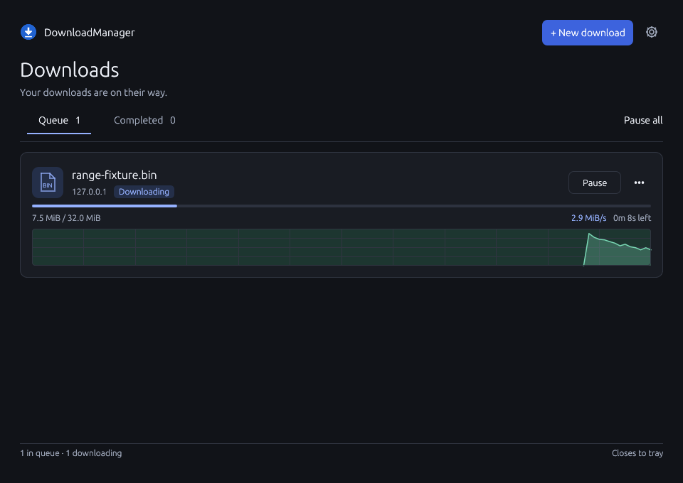

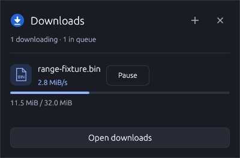

These historical Windows screenshots were captured from the packaged Windows application before the speed graph and parallel controls were added. The queue and new-download views are 960×680 logical pixels, settings are 620×560, and the populated popup is 400×372. The empty popup is 400×256, including its full footer and bottom inset. The queue/history use synthetic paused/error/completed fixtures; no Internet transfer is implied. The isolated settings fixture disables startup checking; new installations enable it by default.

The interface uses a restrained charcoal or light-gray palette, one blue accent, the Windows Segoe UI typeface when installed, and shared spacing and control styles. File rows keep their status and primary action together; errors show a reason and expandable recovery options. Settings use three compact groups with adjacent language and theme controls. Completed files have an explicit Open folder action; downloads are never executed.

Dark is used for new installations and existing settings without a theme preference. Selecting and saving Light preserves that choice across restarts.


<details>
<summary>Empty queue and completed files</summary>

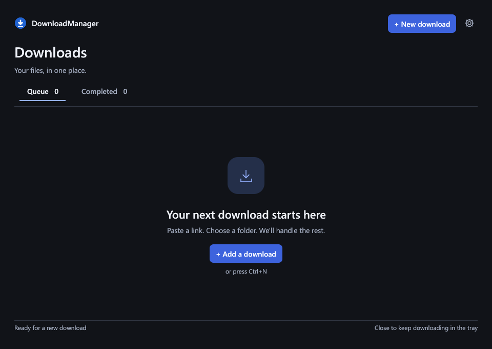

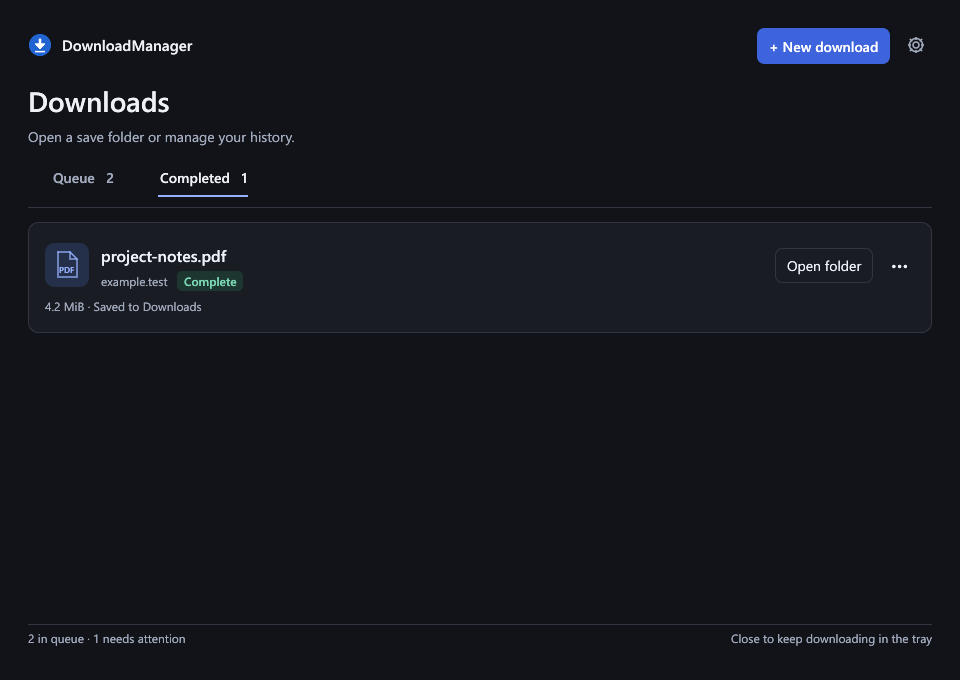

</details>

<details>
<summary>Light theme</summary>


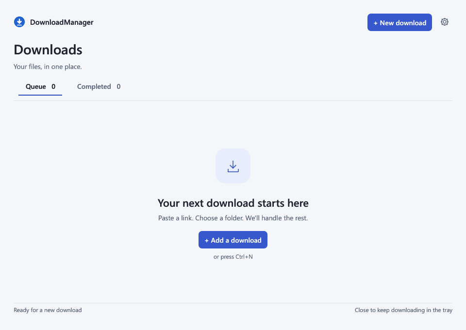

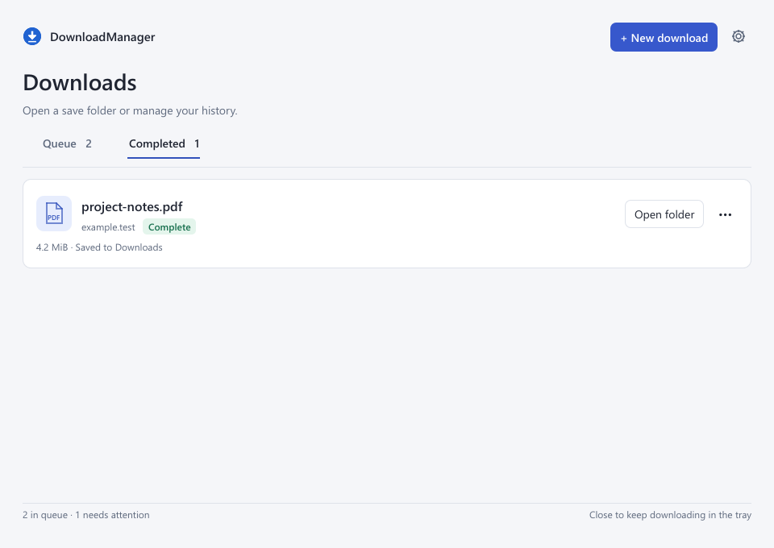

</details>

<details>
<summary>Localized interfaces</summary>

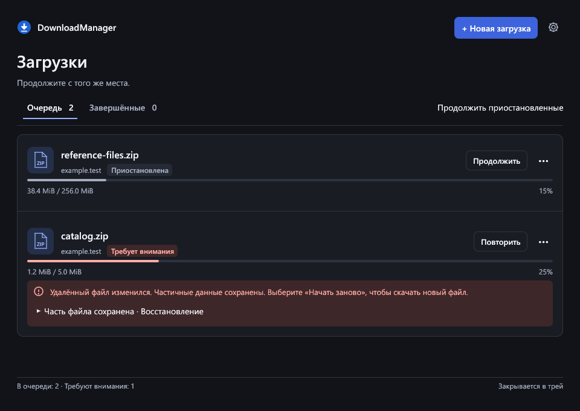

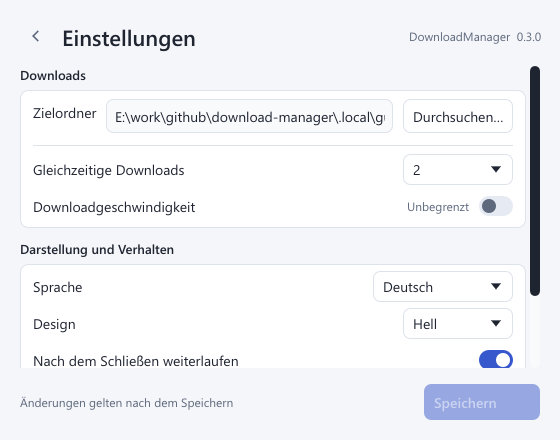

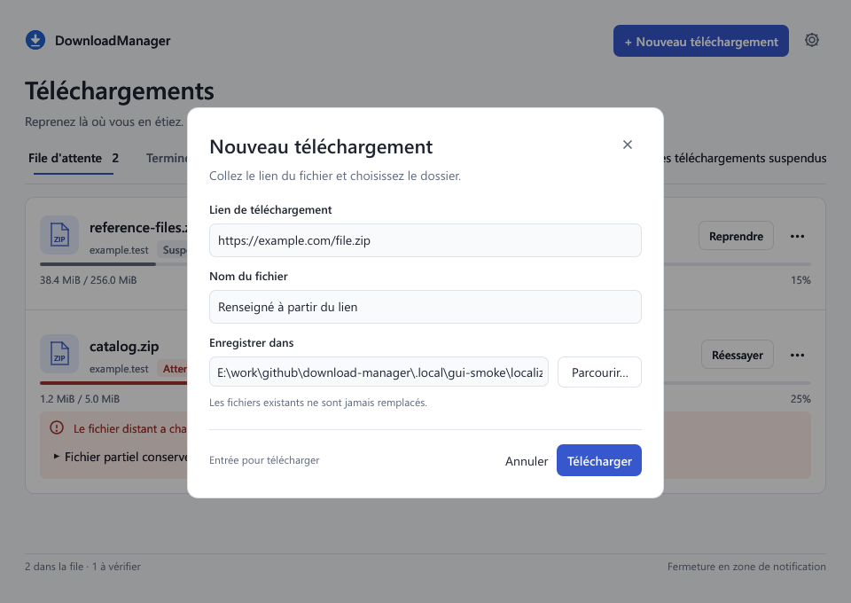

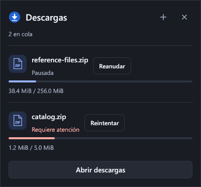

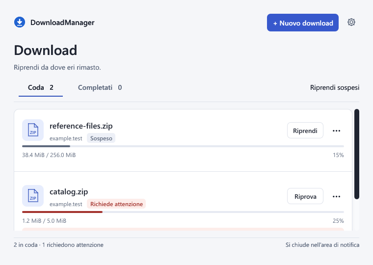

</details>


The empty queue and the minimum 560×440 settings layout were also reviewed. The default settings height is 560 pixels so Language, Theme and startup-update controls fit together. Settings opened from the tray appear beside its icon on the same monitor. Settings resize to a compact window; returning to Downloads restores the queue geometry. Settings scroll at compact sizes while keeping Save changes visible. The save action stays visible while smaller settings windows scroll.

```powershell
./scripts/review-ui.ps1            # Bounded native render-save-exit captures
./scripts/review-ui.ps1 -Diagnose  # Isolated visible/hidden/restore measurements
./scripts/review-ui.ps1 -Theme Light
./scripts/review-ui.ps1 -Diagnose -Theme Light -SkipTray
./scripts/review-localization.ps1           # Real six-language representative captures
./scripts/review-localization.ps1 -Diagnose # Russian dark / German light lifecycle measurements
```

Captures save a complete PNG and exit after readiness and two real frames, with a five-second internal deadline and an eight-second external timeout. They use the same UI and CPU/GDI renderer as normal operation. This verifies the client area, not OS chrome, mouse/keyboard navigation or clipboard behavior. No Computer Use is required. Runtime diagnostics separately count actual layouts, rasters and presentations; screenshots alone do not certify idle behavior.

The v0.3.0 Windows verification passed 38 synthetic and loopback tests, including theme persistence, defaults for older settings and keyboard activation of the settings switches. Windows decodes the packaged EXE icon at all seven sizes. Bounded idle/hidden/restore measurements are recorded in [VERIFICATION.md](docs/VERIFICATION.md). The earlier native tray test was denied with Windows error 5, so actual Shell placement and tray mouse/menu gestures remain unverified; `-SkipTray` explicitly omits that separate test when reviewing themes. Disk-full, power-loss, actual input/clipboard interaction and updater installation still require separate validation.

## License

[MIT](LICENSE). Dependencies retain their own licenses; packaging generates `THIRD_PARTY_NOTICES.txt` from the locked local crate sources for distribution and review.

